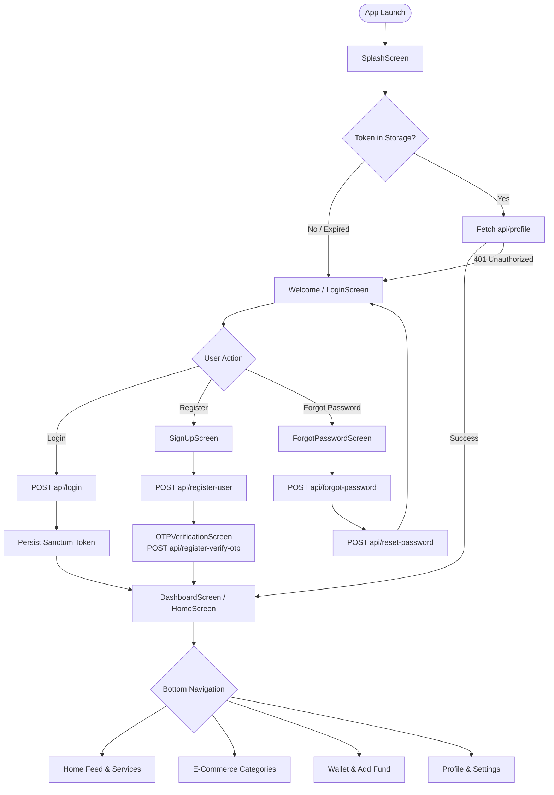
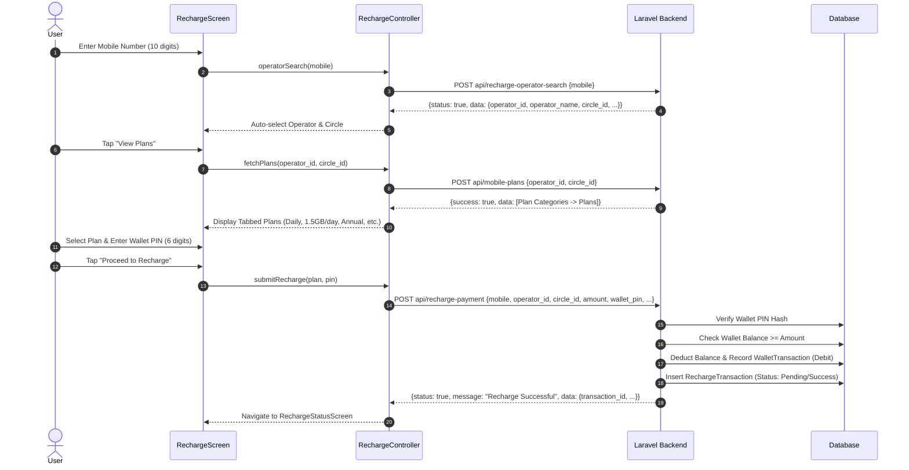
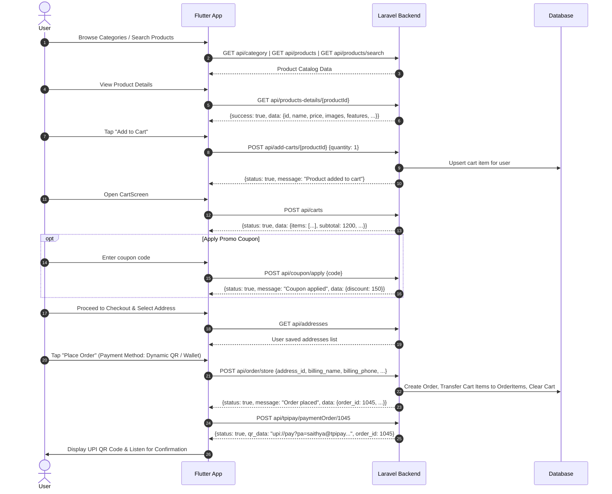

# Saithya Smart / TPIPay — Application Flow & Architecture Specification

## 1. Executive Summary & Overview
This document specifies the end-to-end user journeys, navigation routes, state transitions, API sequences, and server-side processing requirements discovered from the Flutter application (`saithya_smart_tpipay-main`).

The application is a multi-utility financial and e-commerce platform offering:
1. **Authentication & Identity**: Registration, mobile OTP verification, login, forgot password, profile management.
2. **Dashboard & Navigation**: Dynamic banners, categorical quick-links, wallet summary, search, bottom navigation bar (`HomeScreen`, `CategoryScreen`, `WalletScreen`, `ProfileScreen`).
3. **Mobile & DTH Recharge**: Operator detection, circle resolution, prepaid/postpaid plan browsing, wallet PIN verification, balance deduction, transaction tracking.
4. **E-Commerce & Digital Shopping**: Categories, featured products, search/filter, multi-item shopping cart, coupon application, order checkout, address management, TPIPay dynamic QR generation, order detail tracking.
5. **Wallet & Fund Management**: Real-time balance inquiry, manual bank transfer fund requests (with UTR & slip attachment), instant dynamic QR add-fund with gateway status polling, passbook transaction history.
6. **Multi-Tier Referral Network (MLM/Team)**: Referral code generation, multi-level hierarchy visualization (Level 1 to N), downline team member listing, total downline count, rank tracking.
7. **Rewards, Gamification & Subscriptions**: Daily scratch cards, interactive lucky spin wheel, loyalty points to wallet conversion (10 coins = ₹1), membership tiered subscription plans with wallet checkout.
8. **Customer Care & Support**: Live ticket submission, WhatsApp deep-link redirect, direct call/email contacts.

---

## 2. Core User Journey Flowcharts

### 2.1 Complete Application Lifecycle


---

### 2.2 Recharge Flow (Mobile / DTH)


---

### 2.3 E-Commerce Shopping & Checkout Flow


---

### 2.4 Fund Management (Add Fund & Request Fund) Flow
```mermaid
flowchart TD
    StartFund([User Opens Add Fund]) --> MethodChoice{Select Deposit Mode}
    
    MethodChoice -- Instant Dynamic QR (TPIPay) --> EnterAmt[Enter Amount (min ₹100)]
    EnterAmt --> CallCreateOrder[POST api/add-fund/create-order]
    CallCreateOrder --> ShowQR[Display Dynamic UPI QR Code & Countdown]
    ShowQR --> PollStatus[Periodic POST api/add-fund/status\norder_id]
    PollStatus --> CheckState{Status == Success?}
    CheckState -- No / Pending --> PollStatus
    CheckState -- Yes --> CreditWallet[Backend credits wallet balance]
    CreditWallet --> ShowSuccess[Show Success Screen & Return to Wallet]

    MethodChoice -- Bank Transfer / Slip Upload --> FetchBanks[GET api/bank/list]
    FetchBanks --> FillForm[User fills UTR, Amount, Date, Slip Image]
    FillForm --> SubmitRequest[POST api/fund/request/store\nFormData with bank_id, utr, slip, amount]
    SubmitRequest --> PendingState[Admin Review Queue\nStatus: Pending]
    PendingState --> History[View api/fund/request/history\nDetail: api/fund/request/status/{id}/deatils]
```

---

### 2.5 Gamification & MLM Referral Flow
```mermaid
flowchart TD
    subgraph Gamification
        G1[User opens Rewards] --> G2[GET api/rewards]
        G2 --> G3[Display Active Scratch Cards]
        G3 --> G4[User scratches card]
        G4 --> G5[POST api/scratch-cards/scratch/{id}]
        G5 --> G6[Reward Points Credited]
        
        S1[User opens Spin Wheel] --> S2[GET api/spin-wheel/items]
        S2 --> S3[User Spins Wheel]
        S3 --> S4[POST api/spin-wheel/spin]
        S4 --> S5[Points Added to Profile Reward Points]
        
        C1[Convert Points] --> C2[POST api/reward-points/convert\n10 points = ₹1]
        C2 --> C3[Deduct Points, Credit Main Wallet]
    end

    subgraph Referral Network
        R1[User opens Team / Referrals] --> R2[GET api/referrals]
        R2 --> R3[Displays Recursive Hierarchy & Total Referrals]
        R3 --> R4[GET api/referrals/levels]
        R4 --> R5[List Level Counts (Level 1, Level 2...)]
        R5 --> R6[Tap Level N -> GET api/referrals/level/{levelId}]
        R6 --> R7[Displays Members, Rank, Downline Count]
    end
```

---

## 3. Screen-By-Screen Flow & Validation Matrix

| Screen | Primary API Endpoint | Trigger Action | Input Fields & Form Rules | Next Screen on Success | Error Handling |
|---|---|---|---|---|---|
| `SplashScreen` | `GET api/profile` | `onInit()` (if token exists) | None | `DashboardScreen` | Redirects to `LoginScreen` if token missing or 401 |
| `LoginScreen` | `POST api/login` | "Login" button pressed | `mobile` (10 digits), `password` (min 6 chars) | `DashboardScreen` | Shows Snack/Toast with backend `message` |
| `SignUpScreen` | `POST api/register-user` | "Register" button pressed | `first_name`, `last_name`, `mobile`, `email`, `password`, `referral_code` (optional) | `OTPVerificationScreen` | Shows field errors or duplicate alert |
| `OTPVerificationScreen` | `POST api/register-verify-otp` | "Verify OTP" button | `mobile`, `otp` (4-6 digits) | `DashboardScreen` (token stored) | Alert: "Invalid or expired OTP" |
| `ForgotPasswordScreen` | `POST api/forgot-password` | "Send OTP" button | `mobile` (10 digits) | `ResetPasswordScreen` | "Mobile not found" error toast |
| `ResetPasswordScreen` | `POST api/reset-password` | "Reset Password" button | `mobile`, `otp`, `new_password` | `LoginScreen` | "Invalid OTP / Update failed" |
| `ProfileEditScreen` | `POST api/profile-update` | "Save Changes" | `first_name`, `last_name`, `email`, `dob`, `gender`, `image` (multipart) | `ProfileScreen` | Validation error popups |
| `WalletPinScreen` | `POST api/wallet/create-pin` | "Set PIN" | `pin`, `confirm_pin` (6 digits numeric) | `WalletScreen` | Mismatch toast |
| `RechargeScreen` | `POST api/recharge-payment` | "Pay Now" | `mobile`, `operator_id`, `circle_id`, `amount`, `wallet_pin` | `RechargeSuccessScreen` | "Insufficient balance" or "Invalid PIN" |
| `FundRequestScreen` | `POST api/fund/request/store` | "Submit Request" | `bank_id`, `amount`, `trans_date`, `utr`, `slip` (file) | `FundRequestHistoryScreen` | "Duplicate UTR" or missing slip toast |
| `AddFundDynamicQR` | `POST api/add-fund/create-order` | "Generate QR" | `amount` | Dynamic QR modal with polling | "Minimum amount required" |
| `CartScreen` | `POST api/cart/decrease` / `POST api/cart/remove` | Quantity toggle / delete | `product_id` | Refreshes cart view | Error dialog |
| `CheckoutScreen` | `POST api/order/store` | "Place Order" | `address_id`, `billing_name`, `billing_phone`, `billing_email`, `payment_method` | `DynamicQRScreen` or `OrderSuccessScreen` | "Address required" |
| `MembershipScreen` | `POST api/membership/{id}/checkout` | "Subscribe" | `wallet_pin` | Success dialog & unlocks perks | "Insufficient balance" |
| `SupportScreen` | `POST api/support/ticket` | "Submit Ticket" | `subject`, `message`, `attachment` (optional) | Ticket Confirmation | Empty field warnings |
