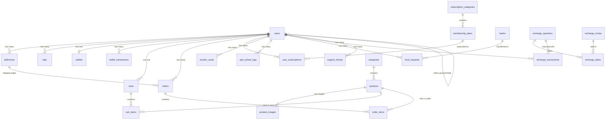

# Saithya Smart / TPIPay — Database Schema Specification

## 1. Overview
The database engine for Saithya Smart is **MySQL 8.0+ / MariaDB 10.4+** with `utf8mb4` encoding and InnoDB storage engine.
This schema covers 28 tables supporting all 66 API endpoints with strict relational integrity, foreign key cascades, unique constraints, and transaction safety.

---

## 2. Entity-Relationship Diagram (ERD)

---

## 3. Complete Table Definitions & Fields

### 3.1 `users` Table
Stores registered consumer and merchant accounts, profile information, wallet security PIN, and referral links.

| Column Name | Type | Modifiers | Description |
|---|---|---|---|
| `id` | `BIGINT UNSIGNED` | `PRIMARY KEY, AUTO_INCREMENT` | Unique User ID |
| `first_name` | `VARCHAR(100)` | `NOT NULL` | User First Name |
| `last_name` | `VARCHAR(100)` | `NULLABLE` | User Last Name |
| `email` | `VARCHAR(150)` | `UNIQUE, NOT NULL` | Verified or primary email address |
| `mobile` | `VARCHAR(20)` | `UNIQUE, NOT NULL` | 10-digit primary mobile number |
| `password` | `VARCHAR(255)` | `NOT NULL` | Bcrypt hashed password |
| `referral_code` | `VARCHAR(20)` | `UNIQUE, NOT NULL` | Unique user referral code |
| `referred_by_id`| `BIGINT UNSIGNED` | `NULLABLE, FOREIGN KEY -> users(id)` | Parent referrer user ID |
| `dob` | `DATE` | `NULLABLE` | Date of Birth |
| `gender` | `VARCHAR(20)` | `NULLABLE` | 'Male', 'Female', 'Other' |
| `image` | `VARCHAR(255)` | `NULLABLE` | Profile avatar relative file path |
| `wallet_pin` | `VARCHAR(255)` | `NULLABLE` | Hashed 6-digit PIN for transactions |
| `reward_points` | `INT UNSIGNED` | `DEFAULT 0` | Gamification point balance |
| `is_verified` | `BOOLEAN` | `DEFAULT FALSE` | OTP verification state |
| `remember_token`| `VARCHAR(100)` | `NULLABLE` | Session token |
| `created_at` | `TIMESTAMP` | `NULLABLE` | Creation timestamp |
| `updated_at` | `TIMESTAMP` | `NULLABLE` | Update timestamp |

*Indexes:*
- `UNIQUE INDEX users_email_unique (email)`
- `UNIQUE INDEX users_mobile_unique (mobile)`
- `UNIQUE INDEX users_referral_code_unique (referral_code)`
- `INDEX users_referred_by_id_index (referred_by_id)`

---

### 3.2 `otps` Table
Stores one-time verification pins for registration and password resets.

| Column Name | Type | Modifiers | Description |
|---|---|---|---|
| `id` | `BIGINT UNSIGNED` | `PRIMARY KEY, AUTO_INCREMENT` | Record ID |
| `mobile` | `VARCHAR(20)` | `NOT NULL` | Target phone number |
| `otp` | `VARCHAR(10)` | `NOT NULL` | 4-6 digit random numeric OTP |
| `type` | `VARCHAR(30)` | `NOT NULL` | `register`, `forgot_password` |
| `expires_at` | `TIMESTAMP` | `NOT NULL` | Valid for 10 minutes from issuance |
| `is_used` | `BOOLEAN` | `DEFAULT FALSE` | Prevents replay attacks |
| `created_at` | `TIMESTAMP` | `NULLABLE` | Created timestamp |
| `updated_at` | `TIMESTAMP` | `NULLABLE` | Updated timestamp |

---

### 3.3 `addresses` Table
Stores user shipping and billing addresses for e-commerce deliveries.

| Column Name | Type | Modifiers | Description |
|---|---|---|---|
| `id` | `BIGINT UNSIGNED` | `PRIMARY KEY, AUTO_INCREMENT` | Address ID |
| `user_id` | `BIGINT UNSIGNED` | `NOT NULL, FK -> users(id) CASCADE` | Owner |
| `street` | `TEXT` | `NOT NULL` | House no, road, building |
| `city` | `VARCHAR(100)` | `NOT NULL` | City / District |
| `state` | `VARCHAR(100)` | `NOT NULL` | State |
| `pincode` | `VARCHAR(20)` | `NOT NULL` | 6-digit postal code |
| `is_default` | `BOOLEAN` | `DEFAULT FALSE` | Primary shipping address |
| `created_at` | `TIMESTAMP` | `NULLABLE` | Creation timestamp |
| `updated_at` | `TIMESTAMP` | `NULLABLE` | Update timestamp |

---

### 3.4 `banners` Table
Hero sliding marketing banners on the home dashboard.

| Column Name | Type | Modifiers | Description |
|---|---|---|---|
| `id` | `BIGINT UNSIGNED` | `PRIMARY KEY, AUTO_INCREMENT` | Banner ID |
| `title` | `VARCHAR(150)` | `NULLABLE` | Banner title |
| `image` | `VARCHAR(255)` | `NOT NULL` | Full/Relative image URL |
| `link` | `VARCHAR(255)` | `NULLABLE` | Action destination URL |
| `status` | `BOOLEAN` | `DEFAULT TRUE` | Active/Inactive |
| `created_at` | `TIMESTAMP` | `NULLABLE` | Creation timestamp |
| `updated_at` | `TIMESTAMP` | `NULLABLE` | Update timestamp |

---

### 3.5 `categories` Table
Product categories for e-commerce catalog.

| Column Name | Type | Modifiers | Description |
|---|---|---|---|
| `id` | `BIGINT UNSIGNED` | `PRIMARY KEY, AUTO_INCREMENT` | Category ID |
| `name` | `VARCHAR(100)` | `NOT NULL` | Category name |
| `slug` | `VARCHAR(120)` | `UNIQUE, NOT NULL` | URL slug |
| `icon` | `VARCHAR(255)` | `NULLABLE` | Category icon asset URL |
| `status` | `BOOLEAN` | `DEFAULT TRUE` | Active/Inactive |
| `created_at` | `TIMESTAMP` | `NULLABLE` | Creation timestamp |
| `updated_at` | `TIMESTAMP` | `NULLABLE` | Update timestamp |

---

### 3.6 `products` & `product_images` Tables
Product inventory, features, pricing, discount, and gallery.

`products`:
- `id` (BIGINT UNSIGNED, PK)
- `category_id` (BIGINT UNSIGNED, FK -> categories(id) CASCADE)
- `name` (VARCHAR(200), NOT NULL)
- `slug` (VARCHAR(220), UNIQUE)
- `description` (LONGTEXT, NULLABLE)
- `price` (DECIMAL(12,2), NOT NULL)
- `discounted_price` (DECIMAL(12,2), NULLABLE)
- `quantity` (INT UNSIGNED, DEFAULT 100)
- `features` (JSON, NULLABLE) — dynamic specification attributes
- `offers` (VARCHAR(255), NULLABLE)
- `offer_type` (VARCHAR(50), NULLABLE)
- `price_category` (VARCHAR(50), NULLABLE)
- `status` (TINYINT, DEFAULT 1)
- `created_at`, `updated_at`

`product_images`:
- `id` (BIGINT UNSIGNED, PK)
- `product_id` (BIGINT UNSIGNED, FK -> products(id) CASCADE)
- `image_url` (VARCHAR(255), NOT NULL)
- `is_primary` (BOOLEAN, DEFAULT FALSE)
- `created_at`, `updated_at`

---

### 3.7 `carts` & `cart_items` Tables
User cart management.

`carts`:
- `id` (BIGINT UNSIGNED, PK)
- `user_id` (BIGINT UNSIGNED, UNIQUE, FK -> users(id) CASCADE)
- `created_at`, `updated_at`

`cart_items`:
- `id` (BIGINT UNSIGNED, PK)
- `cart_id` (BIGINT UNSIGNED, FK -> carts(id) CASCADE)
- `product_id` (BIGINT UNSIGNED, FK -> products(id) CASCADE)
- `quantity` (INT UNSIGNED, DEFAULT 1)
- `price` (DECIMAL(12,2), NOT NULL)
- `created_at`, `updated_at`

---

### 3.8 `coupons` Table
Discount vouchers.

- `id` (BIGINT UNSIGNED, PK)
- `code` (VARCHAR(50), UNIQUE, NOT NULL)
- `type` (ENUM('fixed', 'percent'), DEFAULT 'percent')
- `value` (DECIMAL(10,2), NOT NULL)
- `min_order_amount` (DECIMAL(12,2), DEFAULT 0)
- `max_discount` (DECIMAL(12,2), NULLABLE)
- `expires_at` (TIMESTAMP, NULLABLE)
- `status` (BOOLEAN, DEFAULT TRUE)
- `created_at`, `updated_at`

---

### 3.9 `orders` & `order_items` Tables
E-commerce orders, delivery recipient, subtotal, and dynamic QR state.

`orders`:
- `id` (BIGINT UNSIGNED, PK)
- `order_number` (VARCHAR(50), UNIQUE, NOT NULL)
- `user_id` (BIGINT UNSIGNED, FK -> users(id) CASCADE)
- `address_id` (BIGINT UNSIGNED, NULLABLE, FK -> addresses(id) SET NULL)
- `subtotal` (DECIMAL(12,2), NOT NULL)
- `discount` (DECIMAL(12,2), DEFAULT 0)
- `total_price` (DECIMAL(12,2), NOT NULL)
- `coupon_id` (BIGINT UNSIGNED, NULLABLE, FK -> coupons(id) SET NULL)
- `payment_method` (VARCHAR(50), DEFAULT 'TPIPAY_QR')
- `payment_status` (VARCHAR(30), DEFAULT 'pending')
- `order_status` (VARCHAR(30), DEFAULT 'pending')
- `billing_name` (VARCHAR(150), NOT NULL)
- `billing_phone` (VARCHAR(30), NOT NULL)
- `billing_email` (VARCHAR(150), NULLABLE)
- `qr_data` (TEXT, NULLABLE)
- `created_at`, `updated_at`

`order_items`:
- `id` (BIGINT UNSIGNED, PK)
- `order_id` (BIGINT UNSIGNED, FK -> orders(id) CASCADE)
- `product_id` (BIGINT UNSIGNED, FK -> products(id) CASCADE)
- `product_name` (VARCHAR(200), NOT NULL)
- `price` (DECIMAL(12,2), NOT NULL)
- `quantity` (INT UNSIGNED, NOT NULL)
- `total` (DECIMAL(12,2), NOT NULL)
- `created_at`, `updated_at`

---

### 3.10 `wallets` & `wallet_transactions` Tables
User financial ledger and audit trail.

`wallets`:
- `id` (BIGINT UNSIGNED, PK)
- `user_id` (BIGINT UNSIGNED, UNIQUE, FK -> users(id) CASCADE)
- `balance` (DECIMAL(14,2), DEFAULT 0.00)
- `created_at`, `updated_at`

`wallet_transactions`:
- `id` (BIGINT UNSIGNED, PK)
- `user_id` (BIGINT UNSIGNED, FK -> users(id) CASCADE)
- `wallet_id` (BIGINT UNSIGNED, FK -> wallets(id) CASCADE)
- `type` (ENUM('credit', 'debit'), NOT NULL)
- `amount` (DECIMAL(14,2), NOT NULL)
- `balance_after` (DECIMAL(14,2), NOT NULL)
- `description` (VARCHAR(255), NOT NULL)
- `order_id` (VARCHAR(100), NULLABLE)
- `utr` (VARCHAR(100), NULLABLE)
- `product` (VARCHAR(100), NULLABLE)
- `mobile` (VARCHAR(20), NULLABLE)
- `operator_id` (VARCHAR(50), NULLABLE)
- `operator_txn_id` (VARCHAR(100), NULLABLE)
- `remark` (TEXT, NULLABLE)
- `status` (ENUM('success', 'pending', 'failed'), DEFAULT 'success')
- `created_at`, `updated_at`

---

### 3.11 `subscription_categories`, `membership_plans`, & `user_subscriptions`
Tiered membership packages and user enrollment.

`subscription_categories`:
- `id` (BIGINT UNSIGNED, PK)
- `name` (VARCHAR(100), NOT NULL)
- `description` (TEXT, NULLABLE)
- `status` (BOOLEAN, DEFAULT TRUE)
- `created_at`, `updated_at`

`membership_plans`:
- `id` (BIGINT UNSIGNED, PK)
- `category_id` (BIGINT UNSIGNED, FK -> subscription_categories(id) CASCADE)
- `name` (VARCHAR(150), NOT NULL)
- `price` (DECIMAL(10,2), NOT NULL)
- `discount_price` (DECIMAL(10,2), NULLABLE)
- `validity_days` (INT UNSIGNED, DEFAULT 365)
- `features` (JSON, NULLABLE)
- `status` (BOOLEAN, DEFAULT TRUE)
- `created_at`, `updated_at`

`user_subscriptions`:
- `id` (BIGINT UNSIGNED, PK)
- `user_id` (BIGINT UNSIGNED, FK -> users(id) CASCADE)
- `plan_id` (BIGINT UNSIGNED, FK -> membership_plans(id) CASCADE)
- `start_date` (DATE, NOT NULL)
- `end_date` (DATE, NOT NULL)
- `price_paid` (DECIMAL(10,2), NOT NULL)
- `status` (ENUM('active', 'expired', 'cancelled'), DEFAULT 'active')
- `created_at`, `updated_at`

---

### 3.12 `scratch_cards`, `spin_wheel_items`, & `spin_wheel_logs`
Gamified reward systems.

`scratch_cards`:
- `id` (BIGINT UNSIGNED, PK)
- `user_id` (BIGINT UNSIGNED, FK -> users(id) CASCADE)
- `title` (VARCHAR(100), NOT NULL)
- `min_reward` (INT UNSIGNED, DEFAULT 1)
- `max_reward` (INT UNSIGNED, DEFAULT 100)
- `won_amount` (INT UNSIGNED, NULLABLE)
- `is_scratched` (BOOLEAN, DEFAULT FALSE)
- `scratched_at` (TIMESTAMP, NULLABLE)
- `expires_at` (TIMESTAMP, NULLABLE)
- `created_at`, `updated_at`

`spin_wheel_items`:
- `id` (BIGINT UNSIGNED, PK)
- `label` (VARCHAR(50), NOT NULL)
- `points` (INT UNSIGNED, NOT NULL)
- `color` (VARCHAR(20), NOT NULL)
- `probability` (DECIMAL(5,2), DEFAULT 10.00)
- `status` (BOOLEAN, DEFAULT TRUE)
- `created_at`, `updated_at`

`spin_wheel_logs`:
- `id` (BIGINT UNSIGNED, PK)
- `user_id` (BIGINT UNSIGNED, FK -> users(id) CASCADE)
- `item_id` (BIGINT UNSIGNED, FK -> spin_wheel_items(id) CASCADE)
- `points` (INT UNSIGNED, NOT NULL)
- `created_at`, `updated_at`

---

### 3.13 `banks` & `fund_requests`
Company bank accounts and manual fund deposits with slips.

`banks`:
- `id` (BIGINT UNSIGNED, PK)
- `bank_name` (VARCHAR(150), NOT NULL)
- `account_number` (VARCHAR(50), NOT NULL)
- `account_holder_name` (VARCHAR(150), NOT NULL)
- `ifsc` (VARCHAR(20), NOT NULL)
- `qr_image` (VARCHAR(255), NULLABLE)
- `status` (BOOLEAN, DEFAULT TRUE)
- `created_at`, `updated_at`

`fund_requests`:
- `id` (BIGINT UNSIGNED, PK)
- `user_id` (BIGINT UNSIGNED, FK -> users(id) CASCADE)
- `bank_id` (BIGINT UNSIGNED, FK -> banks(id) CASCADE)
- `amount` (DECIMAL(12,2), NOT NULL)
- `trans_date` (DATE, NOT NULL)
- `utr` (VARCHAR(100), UNIQUE, NOT NULL)
- `slip_image` (VARCHAR(255), NOT NULL)
- `status` (ENUM('pending', 'approved', 'rejected'), DEFAULT 'pending')
- `cancel_reason` (TEXT, NULLABLE)
- `approved_at` (TIMESTAMP, NULLABLE)
- `created_at`, `updated_at`

---

### 3.14 `recharge_operators`, `recharge_circles`, `recharge_plans`, & `recharge_transactions`
Mobile/DTH service provider catalog and transaction logs.

`recharge_operators`:
- `id` (BIGINT UNSIGNED, PK)
- `name` (VARCHAR(100), NOT NULL)
- `code` (VARCHAR(20), UNIQUE, NOT NULL)
- `type` (ENUM('prepaid', 'postpaid', 'dth'), DEFAULT 'prepaid')
- `icon` (VARCHAR(255), NULLABLE)
- `status` (BOOLEAN, DEFAULT TRUE)
- `created_at`, `updated_at`

`recharge_circles`:
- `id` (BIGINT UNSIGNED, PK)
- `name` (VARCHAR(100), NOT NULL)
- `code` (VARCHAR(20), UNIQUE, NOT NULL)
- `status` (BOOLEAN, DEFAULT TRUE)
- `created_at`, `updated_at`

`recharge_plans`:
- `id` (BIGINT UNSIGNED, PK)
- `operator_id` (BIGINT UNSIGNED, FK -> recharge_operators(id) CASCADE)
- `circle_id` (BIGINT UNSIGNED, FK -> recharge_circles(id) CASCADE)
- `category_name` (VARCHAR(100), NOT NULL)
- `plan_amount` (DECIMAL(10,2), NOT NULL)
- `validity` (VARCHAR(50), NOT NULL)
- `talktime` (VARCHAR(50), NULLABLE)
- `data_benefit` (VARCHAR(50), NULLABLE)
- `description` (TEXT, NULLABLE)
- `created_at`, `updated_at`

`recharge_transactions`:
- `id` (BIGINT UNSIGNED, PK)
- `user_id` (BIGINT UNSIGNED, FK -> users(id) CASCADE)
- `mobile` (VARCHAR(20), NOT NULL)
- `operator_id` (BIGINT UNSIGNED, FK -> recharge_operators(id) CASCADE)
- `circle_id` (BIGINT UNSIGNED, FK -> recharge_circles(id) CASCADE)
- `amount` (DECIMAL(10,2), NOT NULL)
- `wallet_tx_id` (BIGINT UNSIGNED, NULLABLE, FK -> wallet_transactions(id) SET NULL)
- `operator_ref` (VARCHAR(100), NULLABLE)
- `status` (ENUM('success', 'pending', 'failed'), DEFAULT 'success')
- `message` (TEXT, NULLABLE)
- `created_at`, `updated_at`

---

### 3.15 `support_tickets` & `app_settings`
Customer inquiries and application-level key/value config.

`support_tickets`:
- `id` (BIGINT UNSIGNED, PK)
- `ticket_number` (VARCHAR(50), UNIQUE, NOT NULL)
- `user_id` (BIGINT UNSIGNED, FK -> users(id) CASCADE)
- `subject` (VARCHAR(200), NOT NULL)
- `message` (TEXT, NOT NULL)
- `attachment` (VARCHAR(255), NULLABLE)
- `status` (ENUM('open', 'in_progress', 'resolved', 'closed'), DEFAULT 'open')
- `created_at`, `updated_at`

`app_settings`:
- `id` (BIGINT UNSIGNED, PK)
- `key` (VARCHAR(100), UNIQUE, NOT NULL)
- `value` (LONGTEXT, NULLABLE)
- `created_at`, `updated_at`
