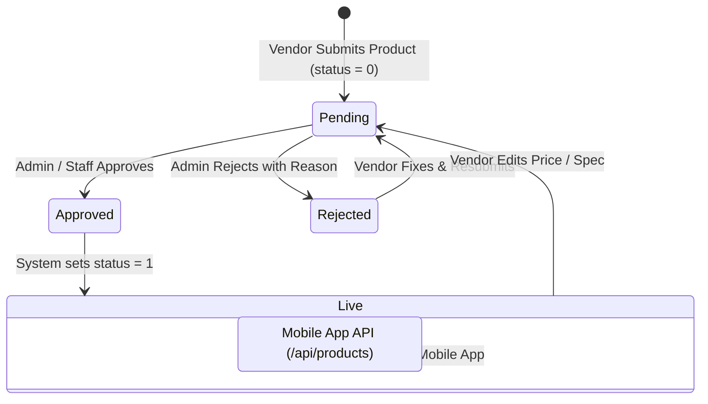

# Role Management & Vendor Product Approval Workflow Specification

## 1. Overview & Architecture
This document details the Multi-Role Access Control (RBAC) and Multi-Vendor E-Commerce Approval Workflow developed for the **Saithya Smart / TPIPay** platform in `D:\Laravel\foozzy\sathyasmart`.

The architecture enforces strict role separation, permission checking, and a multi-stage approval lifecycle for vendor products before they become live in the Flutter mobile application.

---

## 2. Role Hierarchy & Responsibilities

```
                               ┌─────────────────────────┐
                               │       SUPER ADMIN       │
                               │  Full System Authority  │
                               └────────────┬────────────┘
                                            │
                     ┌──────────────────────┴──────────────────────┐
                     ▼                                             ▼
        ┌─────────────────────────┐                   ┌─────────────────────────┐
        │          STAFF          │                   │         VENDOR          │
        │ Delegated Operations &  │                   │ Product Submissions &   │
        │ Product Review/Approval │                   │ Store Management        │
        └─────────────────────────┘                   └────────────┬────────────┘
                                                                   │
                                                                   ▼
                                                      ┌─────────────────────────┐
                                                      │        CUSTOMER         │
                                                      │ Mobile App Consumer     │
                                                      │ Views Approved Catalog  │
                                                      └─────────────────────────┘
```

### 2.1 Role Definitions
1. **`super_admin`**:
   - Master account (`admin@saithyasmart.com`).
   - Can manage roles, permissions, staff accounts, system settings, and finance.
   - Bypasses permission checks automatically.
   - Direct products created by Super Admin are auto-approved and live immediately.
2. **`staff`**:
   - Administrative employees (`staff@saithyasmart.com`).
   - Permissions are assigned granularly by Super Admin (e.g. `products.approve`, `orders.view`, `vendors.view`).
   - Can review pending vendor submissions and approve or reject them.
3. **`vendor`**:
   - Merchants / sellers (`vendor@saithyasmart.com`).
   - Owns a dedicated `VendorProfile` (store name, store slug, business contact, GST, PAN, bank details).
   - Can add, edit, and delete their own products.
   - **Crucial Rule**: Any product added or edited by a vendor defaults to `approval_status = 'pending'` and `status = 0` (inactive/not live). It CANNOT be viewed or purchased by customers until approved by an admin/staff.
4. **`customer`**:
   - Regular mobile application user (`user@example.com`).
   - Default role assigned upon registration.
   - Browses **ONLY** live approved products (`status = 1` AND `approval_status = 'approved'`).

---

## 3. Product Approval Lifecycle



### 3.1 Step-by-Step Flow:
1. **Product Submission**: Vendor calls `POST /api/vendor/products`.
   - The backend records `vendor_id = vendor.id`.
   - The backend forces `approval_status = 'pending'` and `status = 0`.
   - The product is hidden from `/api/products`, `/api/category-details/{id}`, and `/api/products/search`.
2. **Admin Review Queue**: Admin/Staff calls `GET /api/admin/products/pending`.
   - Displays all products waiting for moderation with vendor store details and uploaded images.
3. **Approval Action**: Admin calls `POST /api/admin/products/{id}/approve`.
   - The backend updates `approval_status = 'approved'` and `status = 1` (Live).
   - Sets `approved_by = admin.id` and `approved_at = now()`.
   - The product is immediately visible across the Flutter mobile app catalog.
4. **Rejection Action**: Admin calls `POST /api/admin/products/{id}/reject` with `reason`.
   - The backend updates `approval_status = 'rejected'` and `status = 0`.
   - Stores `rejection_reason`.
   - The vendor sees the rejection reason on their vendor portal so they can modify and resubmit.

---

## 4. API Endpoints Reference

### 4.1 Admin & Staff Endpoints (`/api/admin/`)
*Protected by `auth:sanctum` and `role:super_admin,staff`*

| Method | Endpoint | Access | Description |
|---|---|---|---|
| `GET` | `/api/admin/products/pending` | Super Admin / Staff | List all vendor products waiting for approval |
| `GET` | `/api/admin/products/all` | Super Admin / Staff | List all products with filters (`approval_status`, `vendor_id`, `category_id`) |
| `POST` | `/api/admin/products/{id}/approve` | Super Admin / Staff (`products.approve`) | Approve product to go LIVE in mobile app |
| `POST` | `/api/admin/products/{id}/reject` | Super Admin / Staff (`products.approve`) | Reject product with mandatory `reason` string |
| `GET` | `/api/admin/vendors` | Super Admin / Staff | List all registered vendor stores and stats |
| `GET` | `/api/admin/vendors/{id}` | Super Admin / Staff | Get vendor store details, KYC documents, and products |
| `POST` | `/api/admin/vendors/{id}/status` | Super Admin / Staff | Update vendor store status (`pending`, `approved`, `suspended`) |
| `GET` | `/api/admin/roles` | Super Admin Only | List all roles with assigned permissions and user counts |
| `POST` | `/api/admin/roles` | Super Admin Only | Create new custom role |
| `PUT` | `/api/admin/roles/{id}` | Super Admin Only | Update role name or description |
| `GET` | `/api/admin/permissions` | Super Admin Only | List all permissions grouped by module |
| `POST` | `/api/admin/roles/{id}/permissions` | Super Admin Only | Assign/sync permissions to a role |
| `POST` | `/api/admin/users/{id}/roles` | Super Admin Only | Assign/sync roles to a user (e.g. promote to vendor/staff) |
| `POST` | `/api/admin/users/{id}/permissions` | Super Admin Only | Assign direct override permissions to a user |
| `GET` | `/api/admin/staff` | Super Admin Only | List all staff members with their permissions |
| `POST` | `/api/admin/staff` | Super Admin Only | Create staff member with specific permissions |
| `PUT` | `/api/admin/staff/{id}` | Super Admin Only | Update staff member details or permissions |
| `DELETE` | `/api/admin/staff/{id}` | Super Admin Only | Deactivate/remove staff member |

### 4.2 Vendor Portal Endpoints (`/api/vendor/`)
*Protected by `auth:sanctum` and `role:vendor,super_admin`*

| Method | Endpoint | Description |
|---|---|---|
| `GET` | `/api/vendor/dashboard` | Dashboard metrics (total products, live approved count, pending review count, rejected count) |
| `GET` | `/api/vendor/profile` | View vendor store profile and KYC status |
| `POST` | `/api/vendor/profile` | Update vendor store info, address, bank details |
| `GET` | `/api/vendor/products` | View all products owned by this vendor with approval statuses |
| `POST` | `/api/vendor/products` | Submit new product (auto-assigned `approval_status: pending`, `status: 0`) |
| `GET` | `/api/vendor/products/{id}` | View single product details, approver info, or rejection reason |
| `POST` | `/api/vendor/products/{id}` | Edit product (resets to `pending` review if price/specs modified) |
| `DELETE` | `/api/vendor/products/{id}` | Delete vendor's product |

---

## 5. Seeded Test Credentials

| Role | Email | Mobile | Password | Notes |
|---|---|---|---|---|
| **Super Admin** | `admin@saithyasmart.com` | `9999999999` | `password123` | Full control, role & staff management, approve products |
| **Staff** | `staff@saithyasmart.com` | `9911223344` | `password123` | Product approval permission (`products.approve`), orders view |
| **Vendor** | `vendor@saithyasmart.com` | `9876500000` | `password123` | Verified store: "ElectroTech Deals Hub", adds products |
| **Customer** | `user@example.com` | `9876543210` | `password123` | Mobile app customer, wallet balance ₹5,000, sees only live products |
